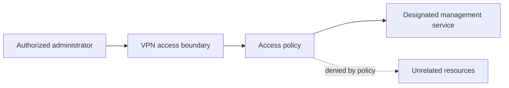

# VPN and connectivity troubleshooting

**Type:** synthetic engineering design case study  
**Focus:** networking, VPN, access boundaries, remote administration

## Scenario

An authorized administrator in a fictional environment can establish a VPN session but cannot reach a designated management service. The design challenge is to diagnose the service path without expanding access to unrelated resources.

## Goal and constraints

Provide the access required for a defined administrative task. Keep user access, management access, and application traffic conceptually separate. Use only role-level diagrams in public material: no real peers, addresses, subnets, routes, firewall rules, keys, or provider details.

## Conceptual access path

This is a fictional access model, not a description of an existing network.

## Diagnostic approach

1. Confirm the expected identity, destination role, permitted action, and observed symptom.
2. Distinguish VPN session establishment from application reachability. Session success does not establish that every downstream dependency works.
3. Inspect name resolution, path selection, policy enforcement, return connectivity, and the target service in a controlled sequence.
4. Compare observations from an authorized working path and the failing path. Keep any operational evidence in a private record.
5. Correct the narrowest demonstrated cause. Do not use broad access rules as a permanent troubleshooting shortcut.

## Failure analysis

| Fictional symptom | Candidate explanation | Evidence to seek |
| --- | --- | --- |
| VPN session works, service name fails | Name-resolution issue | Whether the expected resolver can resolve the intended service |
| Name resolves, connection times out | Path, policy, or return-path issue | Which boundary accepts or rejects the intended flow |
| Connection reaches the destination, request fails | Service or application authorization issue | Target health and the authorized user's permitted action |

These are hypotheses to investigate, not automatic diagnoses.

## Proposed validation

Use an isolated lab with invented identities and service names. Confirm that the approved management action succeeds, unrelated access is denied, and ending the VPN session removes the intended access path. Exercise a failed resolver and a denied policy separately, then verify the diagnosis identifies the correct layer.

**Acceptance criteria:** the required task works; the access boundary remains constrained; a failed path produces enough evidence for diagnosis; rollback returns the lab to its previous access state. No lab results are claimed here.

## Tradeoffs and limitations

Narrow access policies reduce unintended reachability but require accurate service ownership and ongoing review. This study intentionally omits platform-specific commands, cryptographic settings, deployment instructions, and operational topology.
